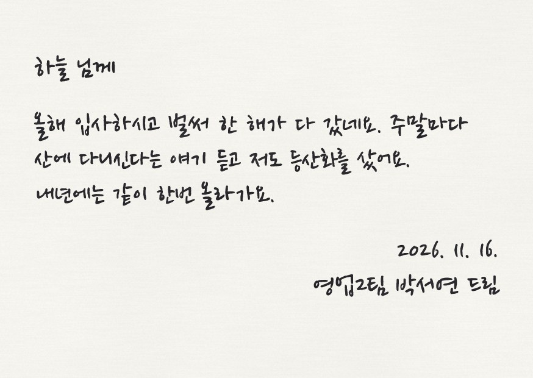
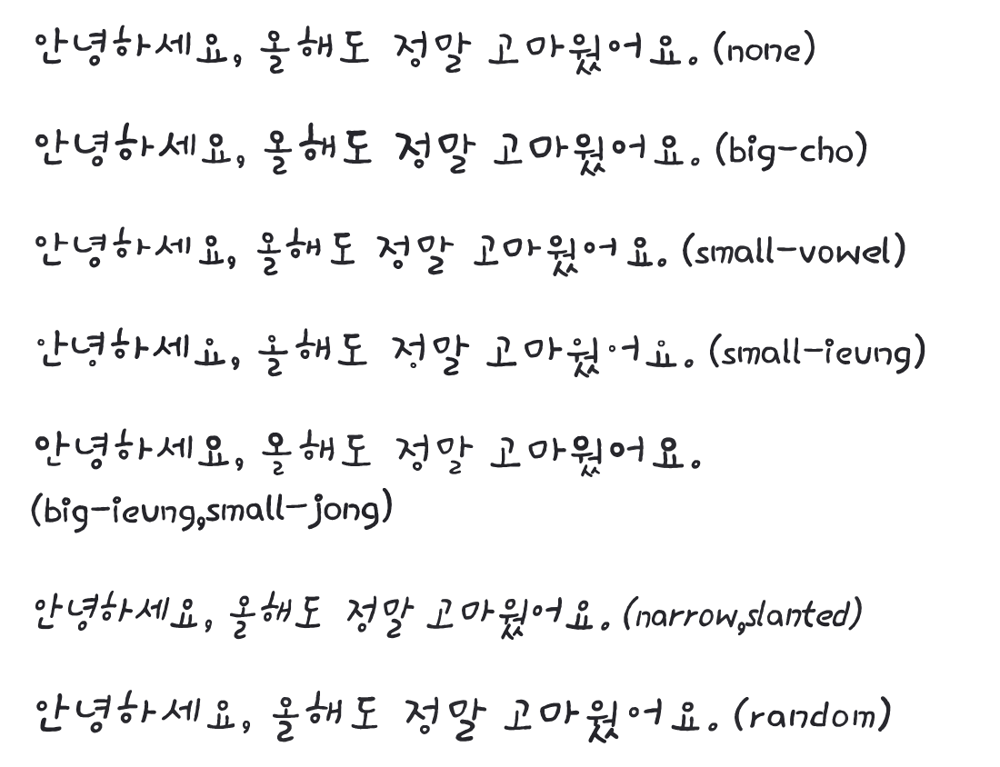
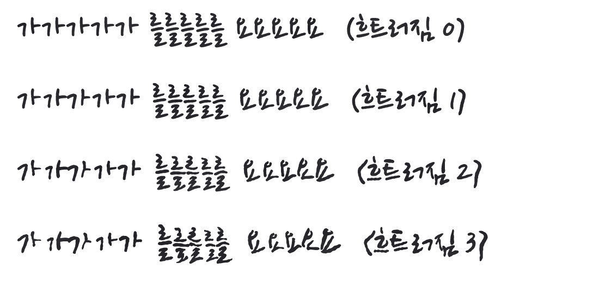
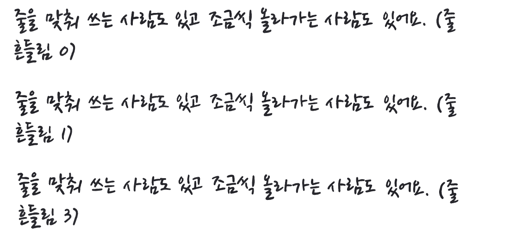
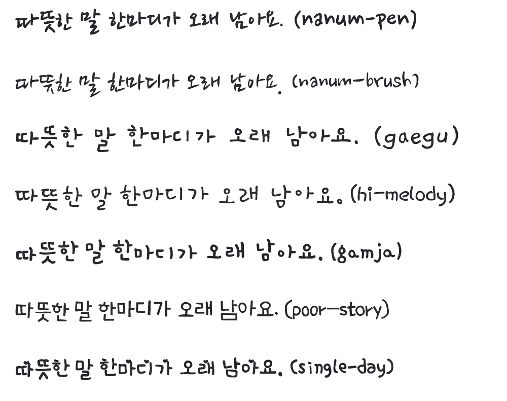
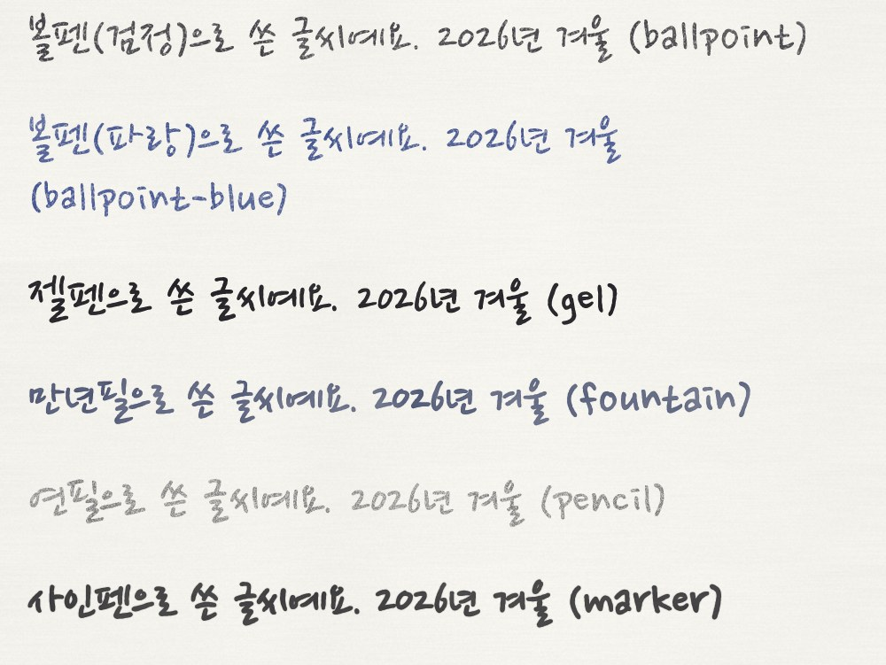
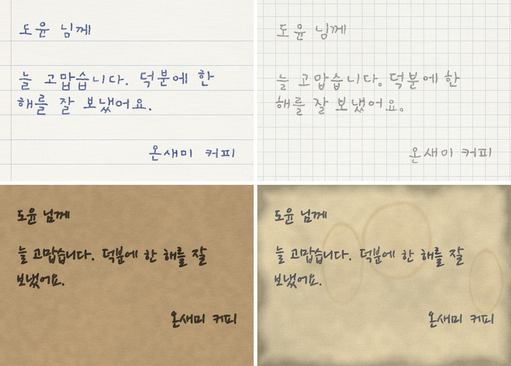
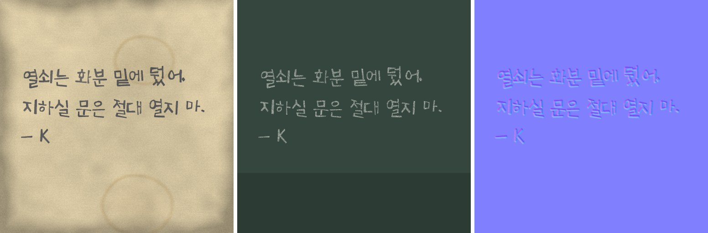

# son-hangul

한글 문장을 **사람이 펜으로 쓴 것 같은 손글씨**로 그려 주는 도구입니다.
받는 사람의 특징을 넣으면 AI가 그 사람만을 위한 따뜻한 한두 마디를 지어 주고, 그 글을 손글씨 이미지나 인쇄용 PDF로 만듭니다.



똑같은 문구를 인쇄해 돌린 카드는 정이 없어 보입니다. 이 도구는 두 가지를 바꿉니다.

- **문구**: 받는 사람의 특징을 하나라도 담은 문장을 사람마다 새로 씁니다.
- **글씨**: 줄과 크기는 고르게 두고, 자음을 크게 쓰거나 모음을 짧게 쓰는 식의 일관된 버릇을 입힙니다. 같은 글자도 쓸 때마다 조금씩 달라서 폰트 티가 나지 않습니다.

쓰임새는 크게 둘입니다.

- **기업용 손편지**: 명단(CSV)을 넣으면 한 사람당 카드 한 장을 인쇄용 PDF로 만듭니다.
- **게임 텍스처**: 편지, 쪽지, 낙서 같은 소품을 투명 PNG, 종이 질감 PNG, 노멀맵으로 뽑습니다.

## 사람 글씨처럼 보이게 하는 세 가지

글자를 아무렇게나 흔들면 사람 글씨가 아니라 손이 떨리는 글씨가 됩니다. 사람은 줄과 크기는 대체로 고르게 쓰고, 대신 사람마다 일관된 버릇이 있습니다.
손글씨 폰트 7종을 재 보니 ㅇ 크기는 1.7배, 초성 높이는 1.4배까지 차이 나는데 글자 전체의 가로세로 비율은 1.1배도 차이 나지 않았습니다([분석](docs/handwriting-analysis.md)).
그래서 세 가지를 따로 조절합니다.

**1. 버릇 (`--habit`)**: 글 전체에 똑같이 나타나는 습관입니다. 같은 폰트, 같은 문장인데 다른 사람이 쓴 것처럼 보입니다.



| 버릇 | 어떤 사람 |
|---|---|
| `big-cho`, `small-cho` | 자음을 크게 / 작게 쓰는 사람 |
| `small-vowel`, `long-vowel` | 모음을 짧게 / 길게 긋는 사람 |
| `big-ieung`, `small-ieung` | ㅇ을 크고 둥글게 / 점처럼 작게 쓰는 사람 |
| `big-jong`, `small-jong` | 받침을 크게 / 작게 쓰는 사람 |
| `narrow`, `wide` | 길쭉하게 / 납작하게 쓰는 사람 |
| `slanted`, `upright` | 오른쪽으로 눕혀 / 꼿꼿하게 쓰는 사람 |
| `random` | 시드로 정한 어떤 한 사람(같은 시드는 늘 같은 사람) |

쉼표로 겹칠 수 있고(`--habit big-cho,small-vowel`), 숫자로 직접 줄 수도 있습니다(`--cho 1.3 --vowel 0.8 --ieung 0.6 --jong 0.9 --glyph-width 0.9 --slant 0.15`).

**2. 흐트러짐 (`--messiness`)**: 쓸 때마다 달라지는 정도입니다. 0 은 폰트 그대로라 같은 글자가 전부 똑같고, 1(기본)은 또박또박 쓴 글씨, 3 은 급하게 쓴 쪽지입니다.



**3. 줄 흔들림 (`--wobble`)**: 줄이 기울고 휘는 정도입니다. 0 은 자를 대고 쓴 듯 곧고, 기본값 1 도 거의 곧습니다.



## 설치

Python 3.10 이상이 필요합니다.

```bash
git clone https://github.com/ryujeehoo/son-hangul.git
cd son-hangul
pip install -e .            # 웹 화면까지 쓰려면: pip install -e ".[web]"
```

손글씨 폰트는 처음 쓸 때 자동으로 내려받습니다(`fonts/_downloads/`). 미리 받으려면 `handwrite fonts --download`.

## 바로 써 보기

```bash
# 글을 손글씨로
handwrite render "오늘도 수고 많으셨어요.\n내일 봬요!" --font gaegu --pen ballpoint --paper lined -o note.png

# 카드 한 장을 인쇄용 PDF로 (A6, 300dpi, 흰 바탕)
handwrite render "한 해 동안 고마웠어요." --page a6 --to "하늘 님께" --from "서연 드림" -o card.pdf

# 버릇을 준 글씨: 자음은 크게, 모음은 짧게 쓰는 사람
handwrite render "늘 건강하세요." --font hi-melody --habit big-cho,small-vowel -o habit.png

# 게임 텍스처: 투명 PNG + 잉크만 + 노멀맵 + 러프니스맵
handwrite render "열쇠는 화분 밑에 뒀어." --pen pencil --width 512 --height 512 --transparent --textures -o note.png
```

`--seed 숫자`를 주면 같은 결과가 다시 나옵니다. 숫자를 바꾸면 같은 글을 "다시 쓴" 것처럼 달라집니다.
`handwrite list` 로 펜·종이·용지 목록을, `handwrite render -h` 로 모든 옵션을 볼 수 있습니다.

## 받는 사람에 맞춘 문구 (AI)

문구는 NVIDIA가 무료로 제공하는 API로 만듭니다.

1. <https://build.nvidia.com> 에 로그인하고, 아무 모델 페이지에서 **Get API Key** 를 누릅니다.
2. `.env.example` 을 `.env` 로 복사하고 `NVIDIA_API_KEY=nvapi-...` 를 채웁니다. `.env` 는 깃에 올라가지 않습니다.

```bash
handwrite compose --name 김하늘 --relation 직원 --traits "올해 입사, 주말마다 등산" \
    --request "한 해 수고했다는 말" --length 2 --variants 3
```

문구 후보 세 개가 나옵니다. `-o card.pdf --page a6 --pick 2` 를 붙이면 두 번째 문구를 바로 카드로 만듭니다.

- 길이: `1`(한 줄), `2`(두 줄), `letter`(짧은 편지)
- 기본 모델은 `nvidia/nemotron-3-ultra-550b-a55b` 입니다(한 번에 20~40초). `.env` 의 `SON_LLM_MODEL` 로 바꿉니다.
- NVIDIA 카탈로그의 모델은 예고 없이 내려갑니다. 기본 모델을 못 쓰게 되면 `SON_LLM_FALLBACKS` 의 모델로 자동으로 넘어갑니다. `handwrite models` 로 지금 올라와 있는 모델을 볼 수 있습니다.
- 같은 입력은 `.cache/` 에 저장해 두고 다시 묻지 않습니다(`--no-cache` 로 끔). 요청이 막히면 간격을 늘려 가며 네 번까지 다시 시도합니다.
- **키가 없으면** 미리 적어 둔 문구에서 고릅니다. 이 문구에는 받는 사람의 특징이 들어가지 않습니다. 화면에 "(미리 적어 둔 문구)"라고 표시됩니다.

## 명단으로 한꺼번에 만들기

[`examples/recipients.csv`](examples/recipients.csv) 처럼 명단을 만듭니다(이름만 필수, 머리글은 한글도 됩니다: 이름, 관계, 특징, 요청, 어조, 길이, 보내는사람).

```bash
# 1) 문구만 먼저 만든다 → out/messages.csv
handwrite batch examples/recipients.csv --page a6 --compose-only -o out

# 2) messages.csv 를 엑셀로 열어 읽어 보고 고친다

# 3) 고친 문구로 카드를 만든다 → 사람마다 PDF 한 장 + all_cards.pdf
handwrite batch --messages out/messages.csv --page a6 -o out
```

AI가 쓴 문구는 **꼭 사람이 읽어 보고** 보내세요. 특징에서 넘겨짚어 없던 일을 지어낼 때가 있습니다(시험 중에 "손글씨를 좋아함"을 "손글씨로 남겨 주신 메모가 위로가 됐다"로 바꿔 썼고, 하지 말라고 지시해도 고쳐지지 않았습니다). 그래서 문구 만들기와 카드 만들기를 나눠 두었습니다. 한 번에 하려면 `--compose-only` 를 빼면 됩니다.
문구는 세 명씩 동시에 만듭니다(`--jobs`). 예시 명단 5명은 34초 걸렸습니다.
한 묶음의 카드는 같은 사람이 쓴 것처럼 버릇과 기울임은 같고, 글자 모양은 장마다 조금씩 다릅니다.

> 명단과 문구 파일에는 실제 이름이 들어갑니다. `recipients*.csv`, `messages*.csv`, `out/` 은 `.gitignore` 로 막아 두었습니다.

## 인쇄할 때

- PDF는 실제 치수(A6 = 105×148mm 등)로 만들어집니다. 프린터 설정에서 **"실제 크기"** 로 인쇄하세요.
- PDF의 기본 종이는 `blank`(흰 바탕)입니다. 카드 용지나 편지지에 잉크만 찍히게 하려는 것입니다. 종이 질감까지 인쇄하려면 `--paper plain` 등을 고릅니다.
- 글씨 크기는 `--size-mm` 로 정합니다(기본 6.5mm, A4·A5는 5.5mm). 글이 넘치면 자동으로 줄여 맞춥니다.
- 용지: `a4`, `a5`, `a6`, `b6`, `postcard`(100×148mm), `square`. 가로는 `--landscape`.
- 샘플: [`docs/samples/card_print.pdf`](docs/samples/card_print.pdf)

## 글씨체, 펜, 종이







| 종이 | 용도 |
|---|---|
| `blank` | 흰 바탕. 실제 카드에 인쇄할 때 |
| `plain` | 미색 무지 |
| `lined`, `grid` | 줄 노트, 모눈. 글씨가 줄 위에 앉습니다 |
| `kraft`, `aged` | 크라프트, 낡은 종이 |
| `transparent` | 배경 없음(투명 PNG) |

## 게임 텍스처



왼쪽부터 낡은 종이 쪽지, 투명 잉크를 다른 배경에 올린 것, 노멀맵입니다.
`--textures` 를 주면 `이름.png` 옆에 `이름_ink.png`(투명 배경 잉크), `이름_normal.png`(펜이 눌린 홈), `이름_roughness.png` 가 함께 나옵니다.
`--messiness 2.5 --wobble 2.5` 처럼 올리면 급하게 쓴 쪽지 느낌이 납니다. `--color "#7a1f1f"` 로 잉크 색을 바꿀 수 있습니다.

## 웹 화면

```bash
pip install -e ".[web]"
handwrite web          # http://127.0.0.1:7860
```

글을 넣고 글씨체·펜·종이·크기·버릇·흐트러짐을 바꿔 가며 미리 보고, PNG와 PDF로 내려받습니다. 문구 만들기도 여기서 할 수 있습니다.

## 파이썬에서 쓰기

```python
from sonhangul.ink import get_pen
from sonhangul.page import PageOptions, letter, page_pixels, render_page
from sonhangul.render import HandStyle
from sonhangul.export import save_pdf

w, h = page_pixels("a6", 300)
page = render_page(
    letter("한 해 동안 고마웠어요.", to="하늘 님께", sender="서연 드림"),
    HandStyle(font="nanum-pen", size=77, seed=1),
    get_pen("gel"),
    PageOptions(width=w, height=h, paper="blank", valign="center"),
)
save_pdf([page], "card.pdf")
```

## 지금 되는 것과 안 되는 것

- 됩니다: 한글·영문·숫자·문장부호 렌더링, 펜 6종, 종이 7종, PNG/PDF/텍스처 내보내기, 명단 일괄 처리, 웹 화면.
- AI 문구 생성은 2026-11-16 에 실제 NVIDIA API 로 명단 5명을 끝까지 돌려 확인했습니다. 무료 API 라 모델과 시간대에 따라 한 번에 몇 초에서 몇 분까지 걸립니다.
- 글씨체는 아래 폰트 7종 안에서 고릅니다. **내 글씨체를 흉내 내는 기능은 아직 없습니다.** 조사한 내용과 다음 계획은 [`docs/research.md`](docs/research.md)에 있습니다.
- 폰트에 없는 글자(이모지, 일부 특수문자)는 건너뛰고 경고합니다. Gaegu 는 자주 쓰는 2,350자만 있어서 나머지 글자는 다른 폰트로 채웁니다.
- 글자를 이어 쓰는 흘림체, 획 순서에 따른 잉크 변화는 표현하지 못합니다(폰트 윤곽선에는 획 순서가 없습니다).
- 버릇은 자모의 크기와 위치만 바꿉니다. ㄹ을 흘려 쓰는 식의 자모 모양 버릇은 없습니다. 획이 서로 붙은 글자(폰트에 따라 14~26%)는 자모를 정확히 가르지 못해 버릇이 덜 정확하게 들어갑니다.
- 버릇의 범위는 폰트 7종을 재서 정했습니다. 실제 사람 글씨 스캔과 견줘 본 것은 아닙니다.

## 폰트와 라이선스

폰트 파일은 이 저장소에 들어 있지 않습니다. 실행할 때 [Google Fonts 저장소](https://github.com/google/fonts/tree/main/ofl)에서 내려받으며, 모두 **SIL Open Font License 1.1** 입니다(상업적 사용과 인쇄물 제작 가능, 폰트 파일만 따로 파는 것은 금지).

| 이름 | 폰트 | 느낌 |
|---|---|---|
| `nanum-pen` | Nanum Pen Script | 빠르게 흘려 쓴 펜 글씨 (기본) |
| `nanum-brush` | Nanum Brush Script | 붓펜 |
| `gaegu` | Gaegu | 동글동글한 메모 글씨 |
| `hi-melody` | Hi Melody | 또박또박 쓴 글씨 |
| `gamja` | Gamja Flower | 귀엽고 둥근 글씨 |
| `poor-story` | Poor Story | 삐뚤빼뚤한 낙서 글씨 |
| `single-day` | Single Day | 얇은 사인펜 글씨 |

## 이렇게는 쓰지 마세요

이 도구는 "손으로 쓴 느낌"을 내는 도구이지 특정인의 필적을 만드는 도구가 아닙니다.
실존 인물의 필체나 서명을 본인 동의 없이 흉내 내거나, 본인이 직접 쓴 문서인 것처럼 속이는 데(계약서, 각서, 자필 증명 등) 쓰지 마세요.
받는 사람이 "직접 썼느냐"고 물으면 사실대로 답할 수 있는 범위에서 쓰기를 권합니다.

## 개발

```bash
pip install -e ".[dev]"
pytest                          # 테스트 (API는 가짜로 대체, 폰트는 처음 한 번 내려받음)
python scripts/make_samples.py  # README 샘플 다시 만들기
python scripts/analyze_fonts.py # 폰트별 자모 비율 재기
```

```
sonhangul/
  fonts.py    폰트 내려받기, 글리프 윤곽선, 대체 폰트
  jamo.py     글리프를 초성·중성·종성으로 나누기
  habits.py   필체 버릇(자모 크기, 폭, 기울임)
  render.py   글자 배치(흐트러짐, 줄 흔들림)와 래스터화
  ink.py      펜 프리셋, 필압·농도·결
  paper.py    종이 질감, 잉크 합성
  page.py     용지 규격, 자동 맞춤, 한 장 만들기
  export.py   PNG, 노멀맵, PDF
  compose.py  NVIDIA API 문장 생성, 캐시, 재시도
  batch.py    명단 → messages.csv → 카드
  cli.py      handwrite 명령
  webui.py    Gradio 화면
```
